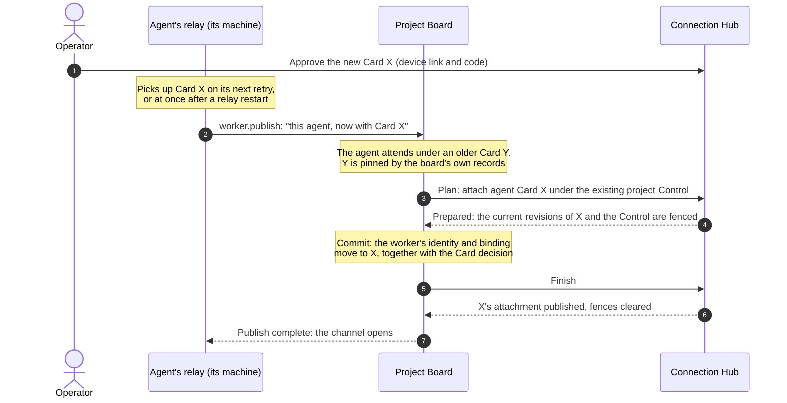

# Cards And Who Edits Them

## The rules

- **Which operations a Card holds is edited in Connection Hub, and only
  there.** Project Board links to a Card, optionally with a preselection or a
  focus for the purpose the link serves; it builds no editor of Card
  operations of its own. The board writes a person's Card once, with the
  role's preselection, when the Card is created, and keeps no later decision
  of its own. Two things are still set from the board: a project admin sets
  the project Control Card's **access rule** (below) in the Project dialog,
  and the coordinator levers apply a Card profile to an agent's Card through
  Connection Hub when the coordinator role moves. The operator's ruling
  (2026-09-26): "it must be cards in the connection hub ... please do not
  build new interface for this, this is simply wrong! and does not scale."
- **How operations are grouped** (Review, Work, Plan, People) is declared with
  the operations in the service catalog, so Connection Hub groups them for
  every client.
- **Who edits which Card in a project.** A project admin (the Project Board
  project's admin role, not a KDCube role) edits every Card the project holds:
  the project Control Card, each person's Control Card (their own and the
  owner's included), and each agent's project Card. A member reads their own Control Card and
  edits only their own My Card, within their Control Card.
- **A new permission reaches people already in the project only when a
  project admin ticks it** on their Cards. A role is a minimum, not a Card
  preset: a promotion establishes the admin minimum on both of the person's
  current Cards, and nothing rewrites the person's other selections.
  `project.cards.manage` is the explicit permission to manage project Cards in
  Connection Hub; no role preset ticks it.
- **The project Control Card caps every agent Card on the project** while its
  access rule is AND (the default), and a Card Refresh is capped by it too:
  after new operations reach the catalog, a project admin ticks them on the
  project Control Card first. With OR, an operation runs if either Card
  allows it (next section).

## Project files

Two operations govern the [project files](concepts.md#project-files):

- `project.set_files` sets the list on the project card: where each file is
  (repository and path), its purpose (instructions, facts, environment) or its
  one-line description. A project admin sets it by role; an agent needs it on
  its Card.
- `project.files.edit` lets an agent edit the files themselves, in its clone,
  as commits. The board cannot see a commit, so the agent checks this operation
  before an edit, and `pb worker context` reports it. Without it, the agent
  proposes the change to the coordinator.

The coordinator's Card has both by default (the coordinator profile holds every
operation). Any other agent needs them ticked on its Card.

`project.github.use` lets an agent get a short-lived GitHub token for a
repository on the project card. Connection Hub issues it under the agent's
owner's GitHub link, after asking the board whether the agent attends the
project now, whether the repository is on the card, and whether the agent's
Card holds this operation. The worker profile holds it; a Card approved
before it existed does not, until its owner or a project admin ticks it.

## The project Control Card and an agent's Card

A project holds one **Control Card** in Connection Hub. It carries no
credential of its own (no token, no expiry) and never calls anything itself.
When an agent is added to the project, the Control Card is attached to the
agent's Card, and every call the agent makes is decided by both, resolved live
at the moment of the call: Project Board stores no copy of what either Card
allows.

- **Access rule.** `AND`, the default: an operation runs only if both the
  agent's Card and the Control Card allow it. `OR`: it runs if either allows
  it. A project admin sets the rule in the board's Project dialog; the board
  asks for confirmation before widening to OR. OR takes effect only for agents
  owned by the person who holds the Control Card; for anyone else's agent, and
  for a person's own Control Card, the rule is always AND.
- **Fails closed.** If the Control Card an agent is linked to is missing,
  revoked, not active, unreadable or being updated, the agent's guarded calls
  are refused; nothing falls back to the agent's Card alone. Revoking the
  Control Card closes every agent linked to it at once.
- **New operations (drift).** A new project's Control Card holds every
  operation of the catalog. When the catalog later gains operations, the
  Control Card takes them on automatically the next time a project owner or
  admin opens the project ([the flow](flows.md#the-project-control-card-follows-the-catalog)).
  An operation an admin removed from the Control Card stays removed, and an
  operation removed from the catalog leaves it and cannot be used even if an
  older Card revision names it. Operator, 2026-10-13 (W807): "B. only when
  project is first created all is added automatically". Other Cards (a
  person's Control and My Card, an agent's Card) still show new operations
  as new and leave them unselected until someone with the right saves them.
- **The refusal names it.** An operation the agent's Card holds but the
  Control Card withholds is refused with
  `work_worker_operation_withheld_by_control_card`, which names the Control
  Card; a new consent on the agent's Card does not help. The fix is on the
  Control Card.
- **A refusal names the permission, never the kind of caller.** The board asks
  every caller one question, whether its Cards hold the operation it calls,
  and a refusal names the operation that is missing and the Card that lacks
  it; an agent whose Card holds an operation may use it. The only refusals
  about who the caller is are a few rules no Card can change (only a person
  moves the coordinator role, for example), and each says it is a rule
  ([rules no Card changes](operations-by-actor.md#rules-no-card-changes)).
- **Leaving the project.** Unlinking an agent removes the Control Card from
  its Card in the same step, after its attendance ends; the agent's own Card
  then applies unchanged. Removing the Control Card from an agent that still
  attends is refused (`control_card_held_by_project`).

## An agent comes back with a new Card

An agent that already attends a project can come back with a **new Card**:
for example, its machine's password store was reset and the credential of its
old Card is gone, so the operator approved a new one. The agent keeps its
place on the project: its membership, role and assignments stay. What changes
is which Card the project's Control Card is attached to. The operator asked
for this to be drawn here (5 November 2026): "draw and document this
mechanism in board docs".

In words:

1. **The operator approves the new Card.** `pb worker authorize <profile> --device`
   prints a link and a code; the operator opens the link on their own device,
   checks it names that agent, and approves.
2. **The relay picks up the new Card**, on its next scheduled retry, or at once
   when it is restarted.
3. **The relay says who it is now.** On connecting it calls `worker.publish`:
   this agent, now with Card X.
4. **The board decides, and moves the project to the new Card in one Card
   transaction.**
   - The board sees that the agent attends under an older Card Y. It proposes
     the ordinary "attach agent" plan for X under the project's existing
     Control Card.
   - Connection Hub prepares it by fencing the current revisions of X and of
     the Control Card, so neither can change underneath.
   - Y is pinned by the board's own records of that agent (its registry entry,
     binding, native identity and owner). Connection Hub neither reads nor
     changes Y.
   - The board commits: the worker's identity and binding move to X together
     with the durable Card decision, or not at all.
   - Connection Hub finishes: it publishes X's attachment and clears the fences.
     Only when that publish has completed does the relay's channel open.
5. **Then the project grants.** A new Card starts without the project grants;
   a project admin presses Team, the agent, **Fit to role**.

What stays and what does not: the agent keeps its attendance, role and
assignments; they belong to the same worker. A revoked Y stays revoked and
keeps its binding record. Even a Y that is still active no longer gives any
attendance once the worker has moved to X. When the move is refused,
`pb status` names Connection Hub's cause, and it does not suggest
`authorize` again when the agent's current profile is in place and the refusal
is not about its credential.

**Today step 4 fails (W1013).** On a build with Card transactions on, the board
still makes this attach as a direct write (`control_card_attach`), and
Connection Hub refuses it with `card_transactions_direct_write_refused`
(HTTP 409). The board reports that as `work_project_control_connection_hub_refused`;
the relay opens the channel and drops it again, and `pb status` keeps suggesting
`authorize`. Re-authorizing, restarting the relay and Fit to role do not help.
W1013 moves the attach into the Card transaction described in step 4, which is
its design as implemented on its draft branch, not yet shipped; until it ships,
an agent with a replacement Card cannot reach its project on such a build.

**Removing and re-adding the agent is not a workaround.** Adding it again still
targets the old Card, and unlinking ends its attendance and detaches its
assignments.
